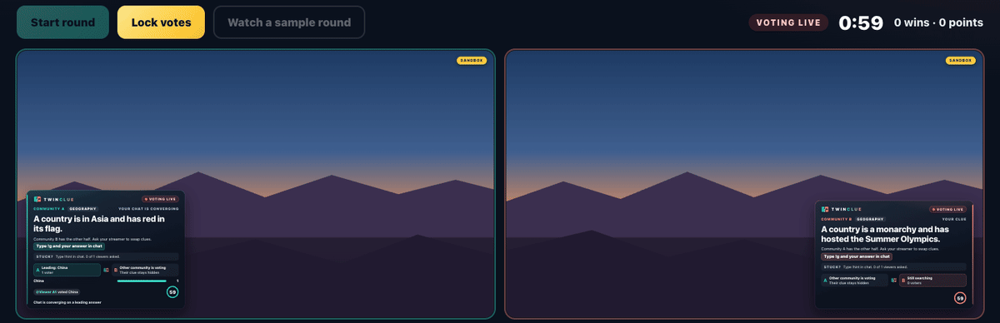

# Twinclue

**Two streamers. Two communities. Each holds half of every clue.**

Twinclue is a cooperative puzzle show for Twitch collabs. Each stream's overlay shows a different half of the same
clue. Viewers vote in their own chat with `!g answer`, and the streamers have to talk to each other on stream to put
the halves together. A round is won only when both communities lock in the right answer.



## Try it in 60 seconds

```sh
npm ci && npm run demo
```

Open the panel link it prints. The demo plays scripted rounds on both overlays: a win with a hint, the swap moment, a
timeout and a round that does not count. To play both chats yourself, run `npm run sandbox` and open
<http://127.0.0.1:3000/>, then press **Watch a sample round** or **Start round**.

## What is real versus simulated

| Part | Status |
| --- | --- |
| Twitch chat in, bot messages out (EventSub WebSocket, Helix Send Chat Message, Shared Chat events, OAuth) | Real. Run live on two real Twitch channels (27 Oct 2026): both channels streamed at once, real chat messages on each channel became votes on the right overlay, and the bot posted in both chats. No scored win yet, because a round needs at least two voters per side. |
| Votes in `npm run demo` | Simulated: a script plays both chats. Overlays say DEMO. |
| Votes in the sandbox (`SANDBOX=1`) | Simulated by you: each vote you type is a new viewer. Overlays say SANDBOX. |
| Throughput numbers in [docs/BENCHMARKS.md](docs/BENCHMARKS.md) | Our real pipeline, fed by a local fake EventSub server. It measures our code, not Twitch delivery. |
| Puzzle audit | Real model calls: a blind solver panel and a two-model fact check ([docs/PUZZLE_AUDIT.md](docs/PUZZLE_AUDIT.md)). The 35 shipped puzzles passed it. |
| Puzzle facts | Curated tables in `facts/`, with sources in each table header. |
| Hints, recap pages, sound cues | Real features; the sound is synthesised in the browser, with no audio files. |

## Built with OpenAI Codex

Codex built slices 1 to 5c in session `01a173c5-a449-71a1-abff-67e5a794156b`, following [AGENTS.md](AGENTS.md) as
its constitution. After the Codex plan's usage limit was reached, another AI coding assistant built the later slices
under the same rules. [CODEX.md](CODEX.md) lists every commit and who built it, and [DECISIONS.md](DECISIONS.md) records
why. Licensed under [MIT](LICENSE).

You can replay the Codex session yourself. Open `/codex` on any Twinclue server (the sandbox, the demo or your own),
or read [docs/CODEX-SESSION.md](docs/CODEX-SESSION.md). The replay shows every message Codex wrote, every command with
its exit code and every test run, taken from the raw `codex exec --json` logs. It is sanitised before it is published,
and a test keeps secrets out of it. `npm run codex:replay` rebuilds it.

A Puzzle Forge builds the clues from curated fact tables, then a blind solver panel and a fact check decide which
ones enter the pack.

## Quickstart (host)

You run one server. Only you sign in with Twitch. Your partner needs nothing but their channel name in your config
and an overlay link from you.

1. **Install.** Node 22, then `npm install`.
2. **Create a Twitch application** at <https://dev.twitch.tv/console>. Set its OAuth redirect URL to
   `PUBLIC_URL/auth/callback` (see step 4 for the URL).
3. **Configure.** Copy `.env.example` to `.env` and fill in:
   - `TWITCH_CLIENT_ID` and `TWITCH_CLIENT_SECRET` from the application.
   - `CHANNEL_A`: your channel login. `CHANNEL_B`: your partner's login (leave it empty to start alone).
   - `BOT_LOGIN`: the account that reads and posts in both chats. Leave it empty to use your own channel account.
   - `ADMIN_TOKEN`: run `openssl rand -hex 24` and paste the result. It protects the control panel.
4. **Get one public HTTPS address.** Your partner's OBS must load their overlay from your server, and Twitch must
   redirect back to it. A Cloudflare Tunnel costs nothing and needs no open ports:
   ```sh
   brew install cloudflared            # or see Cloudflare's docs for your OS
   cloudflared tunnel --url http://127.0.0.1:3000
   ```
   It prints an `https://....trycloudflare.com` address. Put it in `PUBLIC_URL` and in the Twitch application's
   redirect URL. For a stable address, create a named tunnel on your own domain.
5. **Start.** `npm run build && npm start` (or `npm run dev`). The server listens on 127.0.0.1 only; the tunnel
   publishes it.
6. **Open the panel** at `PUBLIC_URL/panel`, enter the admin token, and press **Connect bot account**. Sign in as
   `BOT_LOGIN` (or your own account). A different account is refused.
7. **Add the overlays.** In the panel, **Copy overlay A link** and add it to your OBS as a 1920 x 1080 browser
   source. **Copy overlay B link for streamer B** and send it to your partner. Each link carries its own key, so it
   only shows its own half.
8. **Play.** Press **Start round** (or <kbd>S</kbd>), or a moderator types `!tc start`. The panel's shortcuts are
   <kbd>S</kbd> start, <kbd>L</kbd> lock, <kbd>K</kbd> skip, <kbd>,</kbd> settings and <kbd>?</kbd> help.
9. **End the session.** Press **End session and post recap**. Twinclue builds a shareable page at
   `PUBLIC_URL/recap/<id>` (rounds, wins, best streak, fastest solve, top voters and the best "your half alone"
   moments) and the bot posts one chat line with the link.

### Chat commands

| Command | Who | What it does |
| --- | --- | --- |
| `!g answer` | Everyone | Votes for your community's answer. You can change it; one person votes for one community per round. |
| `!hint` | Everyone | Asks for your community's extra hint line. When 3 viewers (or a fifth of your voters, if more) ask, it unlocks on your overlay only. A win is worth 3 points, minus 1 for each community that used its hint. |
| `!tc start`, `!tc lock` | Moderators and both broadcasters | Starts a round, or locks votes and reveals now. |
| `!tc skip` | Community A's moderators and broadcaster | Skips the round. It does not count. |

### Sound cues

Add `&sound=1` to an overlay link for short synthesised cues: round start, the swap moment, the last 10 seconds, a hint
unlock, the reveal and a win. Sound is off by default, so an OBS source never plays anything you did not ask for. In a normal
browser, click the page once to allow audio.

No partner yet? Turn on **Rehearsal mode** in the panel and type community B's votes yourself. Both overlays and the
panel say "REHEARSAL", and rehearsal rounds never change the score or post in chat.

### Hosted sandbox

`SANDBOX=1` runs a public "try it now" page with no Twitch connection and no admin token. Each browser gets its own
in-memory game (a random cookie, at most `SANDBOX_MAX_GAMES` games, default 200, forgotten after 30 idle minutes),
both overlays side by side with a vote box and a `!hint` button under each, and only audited video-safe puzzles. Every
action is rate limited, and one address can open 20 games per ten minutes.

```sh
npm run sandbox                                   # http://127.0.0.1:3000/
docker run -e SANDBOX=1 -e PUBLIC_URL=https://your-host -p 127.0.0.1:3000:3000 twinclue
```

Set `PUBLIC_URL` to the public address so the browser's Origin is accepted. Behind one proxy, set `TRUST_PROXY=1` so
rate limits see the visitor's address (the right-most `X-Forwarded-For` entry, the one your proxy added); use the
number of proxies if there are more. Leave it empty when nothing sits in front, or anyone could forge an address.

### Video-safe puzzles

`VIDEO_SAFE=1` (or the switch in the panel's settings) deals only audited puzzles from countries, animals, food,
musical instruments, space and sports, so a recorded stream never shows a game character or a brand. The demo and the
sandbox always do this, and the demo plays eight hand-picked showcase puzzles (`src/puzzle/showcase.ts`).

### Docker

```sh
docker build -t twinclue .
docker run --env-file .env -p 127.0.0.1:3000:3000 -v twinclue-data:/app/data twinclue
```

The `data` volume keeps the session (score, streak, the round in progress) and the Twitch tokens across restarts.

## Health and metrics

- `GET /healthz`: the process is up.
- `GET /readyz`: 200 when the bot token is valid and each configured channel's chat subscription is live,
  otherwise 503. Publicly it returns only `{"ready": true}` or `false`; with the admin token it adds the reasons
  in plain words.
- `GET /metrics` with the admin token: Prometheus text (votes, duplicates, reconnects, chat sends, latency).

## How it works

[docs/ARCHITECTURE.md](docs/ARCHITECTURE.md) explains the components, the life of a vote, Twitch limits, failure
modes and security. [docs/BENCHMARKS.md](docs/BENCHMARKS.md) has the measured throughput (`npm run bench`).

## Custom fact tables

Place a CSV file under `facts/custom/` with columns `name,aliases,fame` followed by one or more attribute columns.
Separate multiple aliases or attribute values with `|`. Fame is an integer from 1 to 3. For example:

```csv
name,aliases,fame,neighborhood,river
Old Clock Tower,Clock Tower|The Tower,2,Market Ward,East River
Blue Garden,The Garden,3,Market Ward,East River
Hill Library,Library,2,North Hill,West Brook
```

Run `npm run forge -- --table custom/mycommunity.csv` to search that table, or `npm run forge -- --dry-run` to see
how many candidates each table yields without calling any model. The forge keeps only clues that satisfy the set
constraints, validate, and pass the configured audit panel. Table headers should document sources and the data
license. The uploader is responsible for rights to custom data.

## Development

```sh
npm test            # unit, fault-injection and log-safety tests
npm run typecheck
npm run demo        # local demo with scripted votes, labelled DEMO; prints the panel link with a fresh admin token
npm run bench       # throughput benchmark; rewrites docs/BENCHMARKS.md
```
