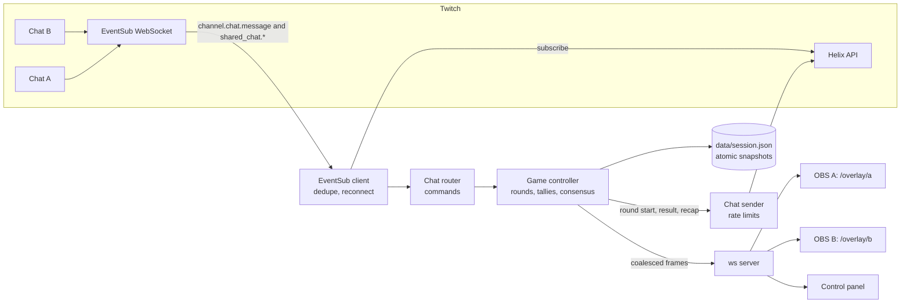

# How Twinclue works

Twinclue is one small Node.js server. It reads two Twitch chats, counts each community's votes, and pushes a
different half of the clue to each streamer's overlay. This page is for someone reading the code cold.

## Components

| Part | File | Job |
| --- | --- | --- |
| EventSub client | `src/twitch/eventsub.ts` | One bot-token WebSocket for both channels. Subscribes, keeps alive, hands off on reconnect, backs off on failure, drops duplicates. |
| Chat router | `src/app/router.ts`, `src/app/commands.ts` | Turns a chat message into a vote or a moderator command. Never replies. |
| Game controller | `src/app/controller.ts` | Starts and ends rounds, applies votes, runs the consensus lock and the timer, builds overlay and panel frames. |
| Round and tally | `src/game/round.ts`, `src/game/vocabulary.ts` | One vote per viewer per side, O(1) leader tracking, the closed vocabulary. |
| Session store | `src/game/session.ts` | Score, streak, bounded history and the live round, written atomically. |
| Web | `src/app/web.ts` | Overlays, panel, API, admin token, overlay keys, health and metrics. |
| Chat sender | `src/twitch/chat.ts` | Posts the bot's three kinds of message within Twitch's limits. |
| Tokens and Helix | `src/twitch/auth.ts`, `src/twitch/helix.ts` | OAuth, validation, refresh, retries. |
| Puzzle Forge | `src/puzzle/*` | Builds clues from fact tables offline. Not on the live path. |

## Why viewers never touch the server

The overlay is a browser source inside OBS. OBS draws it into the video, so viewers see pixels in the stream,
not a page from us. However many people watch, the server has two to four overlay sockets (one per OBS, plus a
preview) and one panel. A big audience costs us only its chat messages, which Twitch delivers over one
WebSocket. Scale therefore means chat throughput, Twitch's API limits, and recovering from failure.

## The life of a vote

1. A viewer in channel B types `!g japan`.
2. Twitch sends a `channel.chat.message` notification on the bot's EventSub socket. If Shared Chat joins A and B,
   a second copy arrives through channel A's subscription with a different `message_id` and with
   `source_broadcaster_user_id` set to B.
3. The EventSub client parses the JSON once, takes the side from the source channel (B), and checks
   `source_message_id ?? message_id` against a bounded dedupe cache. The second copy is dropped and counted.
4. The router matches the `!g` prefix and calls the controller with the viewer's `chatter_user_id`.
5. The round caps the text at 200 characters, checks the blocklist, normalises it, and maps it to an entity of
   the puzzle's fact table (exact name, alias or close spelling, the same way for every entity). The side's
   tally moves the viewer's vote in O(1), indexed by count, so the leader is always known. A change within two
   seconds of the viewer's last change is rejected.
6. The controller marks the frame dirty. At most every 100 ms it builds one frame per view, serialises it once,
   and the ws server sends it to every overlay socket of that view. Overlay B shows "Leading: Japan", the vote
   count and the bars; overlay A shows only its own side and "Other community is voting".
7. If both sides now have a leader with at least 60 percent of their votes (and at least three voters each), a
   five second consensus timer starts. Correctness is never checked before the reveal.
8. At most once a second the vote map is written to `data/session.json` through a temp file and a rename.
9. When the round ends (timer, lock, skip or consensus), the reveal frame goes out at once to both overlays, the
   bot posts the result once in each chat (or once in total under Shared Chat), and the snapshot is written.

## Capacity

From [BENCHMARKS.md](BENCHMARKS.md), measured on an Apple M1 laptop with the load generator on the same machine.
These numbers are for our pipeline, not for Twitch's delivery.

| Load | Messages | Chat to overlay frame p50 / p95 / p99 | Server CPU | Peak RSS | Every vote counted once |
| --- | --- | --- | --- | --- | --- |
| 2,000 per second for 60 s, 100,000 chatters | 120,000 | 54 / 101 / 155 ms | 19% of one core | 117 MB | yes |
| 10,000 per second for 10 s | 100,000 | 52 / 98 / 104 ms | 46% of one core | 138 MB | yes |

About 50 ms of the median is the deliberate 100 ms frame interval. Under load only ticker samples are shed;
votes and round transitions never are.

## Twitch limits we design around

| Limit | Value | What Twinclue does |
| --- | --- | --- |
| Subscriptions on one WebSocket session | All must be created by the same user | One socket with the bot's user token for both channels. |
| EventSub WebSocket connections | 3 per user | One. |
| Subscription cost | 300 total per user | 8 at most (4 per channel), all cost 0. |
| First subscription after welcome | Within 10 seconds or Twitch closes with 4003 | All 8 are sent in parallel immediately after the welcome. |
| Keepalive | `keepalive_timeout_seconds` from the welcome | No message in that window plus 2 seconds means the socket is dead; reconnect. |
| Reconnect URL | Single use | Used once for the handoff, then a fresh session starts from the default URL. |
| Send Chat Message, bot not mod or VIP | 20 per 30 seconds per bot user across all channels, plus 1 per second per channel | Sliding window plus a per-channel gap. Twitch ignores a bot for an hour after a breach. |
| Send Chat Message, bot is mod or VIP | 100 per 30 seconds | Not relied on; the stricter limit is always applied. |
| 429 responses | `Ratelimit-Reset` is a Unix time in seconds | Pause until then, retry at most twice. |
| Dropped chat messages | `is_sent: false` with a `drop_reason` | Counted and logged as a failure. |
| Shared Chat | A message sent with a user token appears in every joined channel | Send once while Shared Chat joins A and B. |
| Token validation | Apps must validate tokens on start and hourly | `/oauth2/validate` at start and every hour; one refresh on 401. |

## Failure modes

| What fails | What the viewer sees | What Twinclue does |
| --- | --- | --- |
| Twitch EventSub outage or dropped socket | Votes pause; the overlay keeps the last state and its countdown | Reconnect with exponential backoff and jitter, capped at 30 seconds; resubscribe on the fresh session. Panel and `/readyz` say which side is down. |
| Twitch asks for a reconnect | Nothing | Open the new URL, keep receiving on the old socket until the new welcome, then close the old one. No resubscribe, no gap, duplicates dropped. |
| Keepalive silence (half-open TCP) | A short pause | Detected within the keepalive window plus 2 seconds; the socket is terminated and replaced. |
| Token expires | Nothing | Refreshed a minute before expiry; concurrent refreshes share one request. |
| Token revoked or subscription revoked | Votes from that channel stop | The panel shows "Re-authorise channel X" with the reason; the other channel keeps working. |
| Server crash or restart | The overlay reconnects in 1.5 seconds | The score, streak and the live round with all votes are restored from the last snapshot (at most one second old), with the round's real end time. |
| Corrupt session file | Score resets | The file is moved aside as `session.json.corrupt-<time>` with an error log, and a fresh session starts. |
| LLM down | Nothing live | Models are used only by the offline Puzzle Forge. The live game never calls a model. |
| Chat flood (10,000 per second) | Overlay frames keep arriving at most 100 ms apart | O(1) work per vote, frames coalesced, ticker sampled, slow sockets skipped and caught up 250 ms later. |
| Bot rate limited or message dropped | A missing round message in chat | Counted in `/metrics`; the overlays are the source of truth. |

## Security and least privilege

- **Scopes.** The bot asks for `user:read:chat` and `user:write:chat`, nothing else. Shared Chat events need no
  scope. Streamer B never signs in; their channel login is enough because the bot reads public chat.
- **Who can sign in.** The OAuth callback validates the new token and refuses it unless its login matches the
  configured account. OAuth states are random, single use and expire after 10 minutes.
- **Tokens at rest.** `data/tokens.json` is written atomically with mode 0600. Tokens never appear in logs: request
  URLs are logged without query strings and token-shaped fields are redacted, which a test checks.
- **Admin token.** The panel API, `/api/*`, `/auth/start` and `/metrics` need `ADMIN_TOKEN` in a header, compared in
  constant time. Requests from another site's Origin are refused.
- **Overlay keys.** Overlay A and B each have their own key, derived from the admin token. The page and its
  WebSocket check the key and the socket checks Origin, so a leaked link for A cannot open B.
- **Fairness.** The panel never receives either clue half, frames never carry an answer key, the vote bars show
  only fact-table entities, and an early lock never depends on correctness.
- **Network.** The server binds to 127.0.0.1 unless `PUBLIC=1`. A Cloudflare Tunnel gives one HTTPS URL for the
  OAuth redirect and streamer B's overlay without opening a port.

## Hosted, multi-tenant design (design only, not built)

Twinclue today is self-hosted: one server per collab. A hosted service for many collabs at once would change
the Twitch side like this:

- **EventSub Conduits.** Conduits need an app access token. Each conduit has up to 20,000 shards, and each shard is
  a WebSocket or a webhook. Subscriptions are created against the conduit rather than a session, so a process can
  restart without losing them.
- **Authorisation.** With an app token, `channel.chat.message` needs `user:bot` from the bot account and
  `channel:bot` from each broadcaster (or the bot as a moderator). We would ask streamers to mod the bot, which also
  raises its chat limit to 100 messages per 30 seconds.
- **Routing.** Twitch spreads notifications across shards by channel, so the two halves of one collab can land on
  different shards. Each shard would publish votes to a shared store such as Redis, keyed by collab pair, and one
  game worker per pair would own the tally.
- **State.** Postgres would hold sessions, history and per-community stats; Redis would hold live tallies.
- **Overlays.** Still one browser source per streamer, served from a stateless edge that subscribes to its pair's
  frames.
